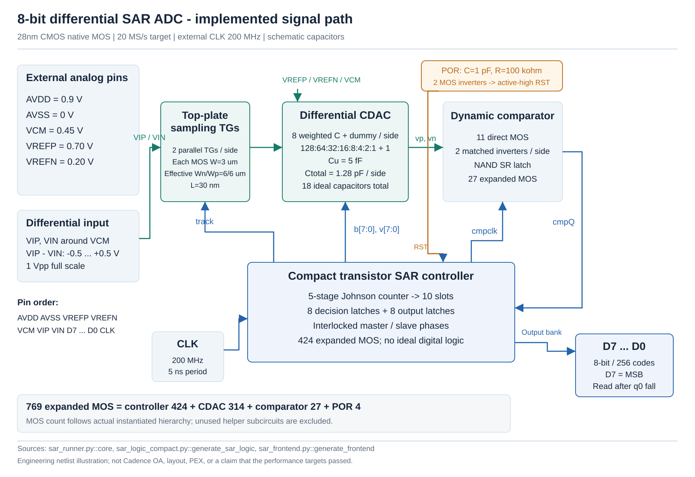
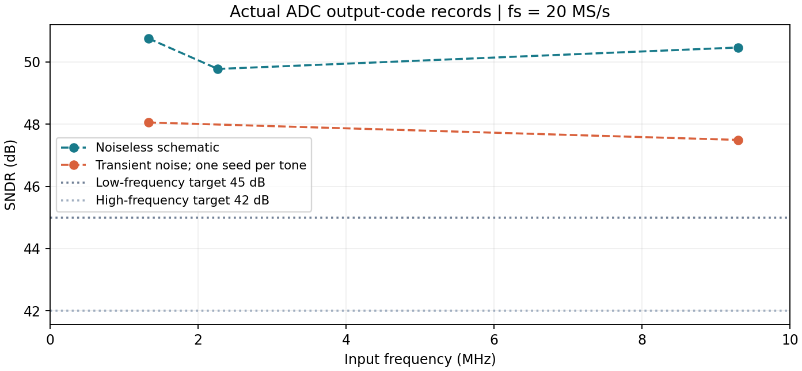

# 28nm Differential SAR ADC

An **8-bit, 20 MS/s, 0.9 V schematic prototype**, simulated with licensed 28nm CMOS process models in Cadence Spectre. The declared prototype gate passed for the saved tests. This repository publishes authored geometry/connectivity, engineering figures, compact simulation exports and analysis tools. It contains no process models or simulator environment.

**8 bit means 256 output codes.** The two transient-noise records give **7.60–7.69 ENOB**, not eight effective bits. These are simulation results, not measured silicon.

[Architecture and implementation](docs/architecture.md) · [Validation scope](docs/validation-scope.md) · [Reproduce the exported analysis](docs/reproduction.md)

| Study | Implementation | Saved evidence |
|---|---|---|
| Conversion | Fully differential charge-redistribution SAR, dynamic comparator and native transistor logic | [Nominal topology](design/topology.json), 769 expanded MOS |
| Control | Five-stage Johnson counter, 10 clock slots, static TG storage | 200 MHz clock; two nominal acquisition slots and eight comparisons |
| Dynamic | Coherent 256-conversion output-code FFT; all nonfundamental AC bins retained | Five [exported records](data/dynamic/records.json), including two noisy records |
| Static | Complete-conversion threshold brackets; endpoint-fit uncertainty propagation | Five corners, 553 observations and all 256 codes per corner |
| History/tolerance | Selected reverse anchors and central-boundary tests | Strict 70-anchor equality remains **false**; 69 match, exact-zero decision depends on history |
| CAD export | Historical saved/reopened OA, native connectivity/CDF audit and eight-conversion DC smoke | [Scoped evidence](evidence/oa_export.json); CAD binaries excluded |

## Architecture



The CDAC uses 5 fF ideal units, binary weights 128:64:32:16:8:4:2:1 and one dummy unit per side: 1.28 pF per side. The regenerative comparator has isolation buffers and an SR hold. The compact controller uses five Johnson-counter flip-flops, conversion latches, output latches and native interlocked clock phases.

These are source-derived engineering illustrations, not layout or a screenshot of a CAD schematic. [CDAC](figures/adc_cdac.svg), [comparator](figures/adc_comparator.svg) and [controller timing](figures/adc_controller_timing.svg) show the implementation details.

## Simulated results

Conditions: 0.9 V, 25 °C, 20 MS/s, 1 Vpp nominal differential full scale; tone amplitude 0.95 of full scale. Dynamic tests use TT. Capacitors are ideal schematic elements.

| Input tone | Transient noise | SNDR | ENOB formula | Core AVDD power |
|---|---:|---:|---:|---:|
| 1.328125 MHz | Off | 50.754 dB | 8.139 | 46.009 µW |
| 2.265625 MHz | Off | 49.775 dB | 7.976 | 46.103 µW |
| 9.296875 MHz | Off | 50.463 dB | 8.090 | 46.385 µW |
| 1.328125 MHz | On, seed 43 | **48.054 dB** | **7.690** | **46.000 µW** |
| 9.296875 MHz | On, seed 79 | **47.494 dB** | **7.597** | **46.380 µW** |

The selected low/high-tone targets are 45/42 dB. Short noiseless coherent records can produce an ENOB formula above eight; this is not a physical precision claim. No amplitude correction, harmonic exclusion or best-bin search is used. Each noisy tone has one 256-sample record; the effective model-noise band is approximately 74.627 kHz–10 GHz.



TT/SS/FF/SF/FS deterministic, noiseless static tests observed all 256 codes. Across these saved brackets, conservative worst-magnitude bounds are **DNL 0.251154 LSB** and **INL 0.190113 LSB**, within the declared ±0.5/±1 LSB limits. Endpoint fitting removes offset/gain; DNL covers bounded interior codes 1–254.

At exactly 0 V, tested histories produce code 127 or 128. The original reverse-history comparison is 69/70, and remains a failed equality diagnostic. The selected ±20 µV tests under two tolerances provide a conditional central-transition band. The final interval uses the **union** with the original wider bracket, rather than silently narrowing it. See [validation scope](docs/validation-scope.md).

AVDD is the ADC supply. Signed ideal reference, common-mode and clock-source contributions are published separately. Physical input/reference/clock drivers are not implemented or included as a complete system budget.

## Reproduce

Python 3.9+ and its standard library are sufficient:

```sh
python tools/verify_release.py
python tools/reproduce_all.py --outdir reproduced
```

This verifies release hashes and recomputes FFTs, conservative static intervals, the central-boundary union and nominal hierarchy counts from the published exports. It does **not** rerun transistor simulations, reintegrate raw supply currents or rederive saved input/timing flags. The output folder must be new.

## Simulation and physical scope

New transistor simulations require separately authorized process models, native parameter bindings, a compatible simulator and a reviewed external testbench. The symbolic [connectivity netlist](design/adc_topology.scs) deliberately contains undefined `NMOS_CORE`/`PMOS_CORE` names; it is not a simulation-ready model substitute.

No physical capacitor mismatch, layout, DRC/LVS/PEX, voltage/temperature sweep, yield, driver implementation, exact ERBW crossing or silicon measurement is qualified. Historical OA/DC smoke does not replace the separate ADC tests. The [validation scope](docs/validation-scope.md) records these limits and the recovered-run provenance caveat.
