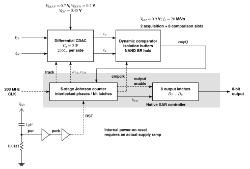
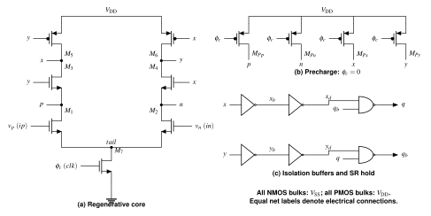

# 8-bit Differential SAR ADC

An **8-bit, 20 MS/s, 0.9 V differential SAR ADC schematic prototype**, simulated with licensed 28 nm CMOS process models in Cadence Spectre. The design combines a charge-redistribution CDAC, a regenerative comparator and a transistor-level Johnson-counter controller.

The declared prototype gate passed for the saved tests. The results below are historical circuit simulations; drawing and packaging the design do not constitute new simulations or measured silicon. **Eight bits means 256 output codes.** The two transient-noise records give **7.597–7.690 ENOB**, not eight effective bits.

| Historical schematic result | Value |
|---|---:|
| Nominal resolution and sample rate | 8 bit, 20 MS/s |
| Supply and temperature | 0.9 V, 25 °C |
| Nominal differential full scale | 1 Vpp |
| Noisy SNDR, low / high input tone | 48.054 / 47.494 dB |
| Noisy ENOB, low / high input tone | 7.690 / 7.597 |
| Reported core AVDD power, noisy low / high tone | 46.000 / 46.380 µW |
| Conservative DNL / INL worst-magnitude bounds | 0.251154 / 0.190113 LSB |
| Active implementation | 769 expanded MOS, 16 hierarchy cells |

Dynamic results are TT, with one 256-conversion record per condition. Static bounds cover the retained noiseless TT/SS/FF/SF/FS brackets; they are not mismatch or yield estimates. The original reverse-history comparison remains **69/70**, with one exact-zero code mismatch.

## Read the design

The [IEEE-style design report](report/sar-adc-8bit.pdf) presents the architecture, historical results and black-and-white CircuitikZ schematics using American circuit symbols. [Editable LaTeX and build instructions](report/README.md) accompany the PDF; the main source is [main.tex](report/main.tex).



- [Architecture and implementation](docs/architecture.md): CDAC switching, comparator, controller timing and nominal device geometry.
- [Results and acceptance criteria](docs/results.md): dynamic records, deterministic static intervals and the retained history diagnostic.
- [Validation scope](docs/validation-scope.md): what the saved tests establish and what remains unqualified.
- [Exported topology](design/adc_topology.scs) and [cell inventory](design/topology.json): authored connections and nominal dimensions.

The CDAC uses 5 fF ideal units, binary weights 128:64:32:16:8:4:2:1 and one dummy unit per side: 1.28 pF per side. The regenerative comparator has isolation buffers and an SR hold. The compact controller uses five Johnson-counter flip-flops, conversion latches, output latches and native interlocked clock phases.



These source-derived schematics document the electrical design; they are not CAD screenshots, layout or an editable OA database. The [CDAC array](report/figures/cdac.svg), [CDAC switch detail](report/figures/cdac-switch.svg), [native CMOS cells](report/figures/logic-cells.svg), [storage hierarchy](report/figures/logic-latch.svg) and [Johnson controller](report/figures/controller.svg) provide complementary views. The report and standalone circuit figures use the same LaTeX drawing sources. Each drawing has an [editable TeX, PDF and white-background SVG](report/README.md).

## Reproduce the saved results

Python 3.9+ and its standard library are sufficient:

```sh
python tools/verify_release.py
python tools/reproduce_all.py --outdir reproduced
```

This verifies release hashes and recomputes FFTs, conservative static intervals, the central-boundary union and nominal hierarchy counts from the published exports. It does **not** rerun transistor simulations, reintegrate raw supply currents or rederive saved input/timing flags. The output folder must be new. See [reproduction details](docs/reproduction.md) for the evidence boundaries and [report build instructions](report/README.md) for regenerating the paper and figures.

## What is verified

The saved evidence supports the declared schematic prototype under its documented test conditions. The CDAC capacitors and external reference, common-mode, input and clock sources are ideal. AVDD is the ADC core supply; signed ideal-source contributions are published separately. Physical input/reference/clock drivers are not implemented or included as a complete system-power budget.

New transistor simulations require separately authorized process models, native parameter bindings, a compatible simulator and a reviewed external testbench. The symbolic [connectivity netlist](design/adc_topology.scs) deliberately contains undefined `NMOS_CORE`/`PMOS_CORE` names; it is not a simulation-ready model substitute.

No physical capacitor mismatch, layout, DRC/LVS/PEX, voltage/temperature sweep, yield, driver implementation, exact ERBW crossing or silicon measurement is qualified. Historical OA/DC smoke does not replace the separate ADC tests. The [validation scope](docs/validation-scope.md) records these limits and the recovered-run provenance caveat.
