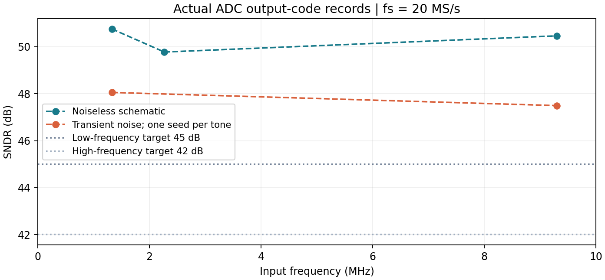
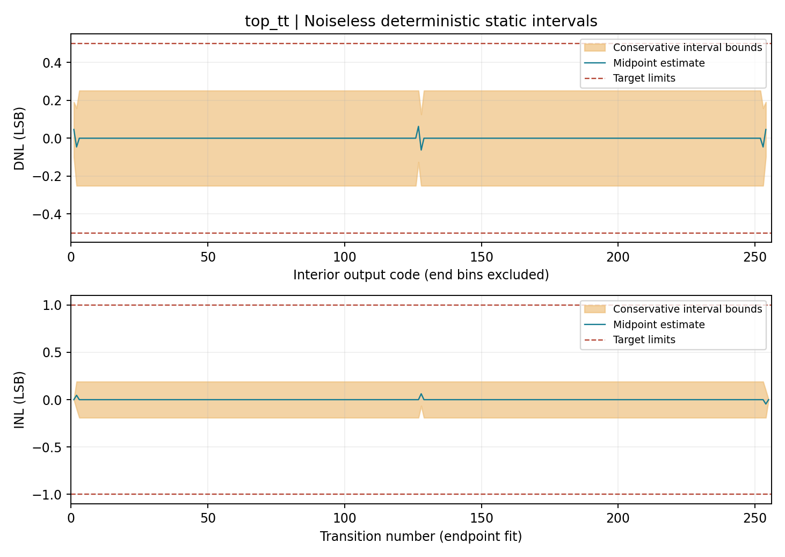

# Results and acceptance criteria

These are historical schematic simulation results from the published data exports. The report and CircuitikZ drawings introduce no new circuit measurement or qualification. [Validation scope](validation-scope.md) records the detailed measurement definitions and provenance limitations.

## Dynamic results

Conditions: 0.9 V, 25 °C, 20 MS/s, 1 Vpp nominal differential full scale; coherent tone amplitude 0.95 of full scale. Dynamic tests use TT and ideal schematic capacitors. Each row uses 256 settled output codes, with the original acquisition and read timestamps retained in the [data exports](../data/dynamic/records.json).

| Input tone | Transient noise | SNDR | ENOB formula | Core AVDD power |
|---|---:|---:|---:|---:|
| 1.328125 MHz | Off | 50.754 dB | 8.139 | 46.009 µW |
| 2.265625 MHz | Off | 49.775 dB | 7.976 | 46.103 µW |
| 9.296875 MHz | Off | 50.463 dB | 8.090 | 46.385 µW |
| 1.328125 MHz | On, seed 43 | **48.054 dB** | **7.690** | **46.000 µW** |
| 9.296875 MHz | On, seed 79 | **47.494 dB** | **7.597** | **46.380 µW** |

The selected low/high-tone SNDR targets are 45/42 dB. Eight nominal bits means 256 output codes. Short noiseless coherent records can produce an ENOB formula above eight; this is not a physical precision claim. No amplitude correction, harmonic exclusion or best-bin search is used. Each noisy tone has one 256-sample record; the effective model-noise band is approximately 74.627 kHz to 10 GHz.

AVDD is the ADC core supply. Signed ideal reference, common-mode and clock-source contributions are published separately. Negative contributions represent returned energy. Offline tools verify aggregate arithmetic but do not reintegrate raw currents. Physical input/reference/clock drivers are not implemented or included as a complete system-power budget.

## Deterministic static results

The saved TT/SS/FF/SF/FS noiseless tests each contain 553 observations and cover all 256 codes. Across these saved brackets, conservative worst-magnitude bounds are **DNL 0.251154 LSB** and **INL 0.190113 LSB**, within the declared ±0.5/±1 LSB limits.

These are endpoint-fit interval bounds with propagated input and fitted-LSB uncertainty. Endpoint fitting removes offset and gain. DNL covers bounded interior codes 1–254; saturated end-bin widths are not bounded by this test. The records do not establish capacitor mismatch, voltage/temperature coverage or yield.

## Retained history diagnostic

The original reverse-history comparison is **69/70**, and strict equality remains **false**. At exactly 0 V, tested histories produce code 127 or 128. Under both tested numerical tolerances, the selected ±20 µV probes produce the adjacent codes consistently.

The central-transition interval uses the **union** of the measured history/tolerance band with the original wider forward bracket. It does not narrow away the original possible threshold values. Other transitions retain their forward brackets, so the selected reverse anchors do not establish all transitions under all histories. The [history exports](../data/history/zero_boundary.json) and [original comparison](../data/history/reverse_70_anchors.json) retain both the failed diagnostic and its follow-up evidence.

## CAD export and qualification boundary

The [historical OA evidence](../evidence/oa_export.json) records a saved/reopened hierarchy, native connectivity/CDF audit and eight-conversion DC smoke. CAD binaries are excluded. That smoke test does not substitute for the separate ADC dynamic and static evidence.

The [declared gate](../evidence/declared_gate.json) applies to the saved schematic prototype. Layout, DRC/LVS/PEX, physical capacitor mismatch, physical drivers, extensive noisy/PVT ensembles, yield, exact ERBW crossing and silicon behavior remain unqualified.
